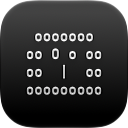

## HOW-TO

1024&ndash;256 px | 128 px | 64&ndash;16 px
---|---|---
 |  | 

1. nainstalovat aplikaci Icon Composer
[https://developer.apple.com/icon-composer]
   - u macOS 15 a starších: stáhnout šablonu ze stránky:
     [https://developer.apple.com/design/resources/#macos-apps]&nbsp;&ndash;&nbsp;otevře např. Figma nebo GIMP (nutné převést na sRGB profil)
2.
   - vytvořit vizuálně vyhovující sadu ikon
   - jednotlivé ikony vyexportovat jako PNG do složky [mac-ico.iconset]
     se správnými názvy pro macOS utilitu [iconutil]
3. PNG ideálně převést na barevný profil P3 pomocí ColorSync Utility v macOS
4. použít CLI utilitu [iconutil -c icns mac-ico.iconset] pro finální ikonu

### Použitý software
- Icon Composer *(ver. 27.1&nbsp;&ndash;&nbsp;Xcode 27.1)*
- iconutil (macOS 27.0.1 Golden Gate)
