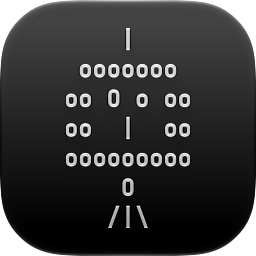

## HOW-TO

1024&ndash;256 px | 128 px | 64&ndash;16 px
---|---|---
 |  | 

1. nainstalovat aplikaci Icon Composer
[https://developer.apple.com/icon-composer]
2. vytvořit vizuálně vyhovující sadu ikon pro různé velikosti (uložit je ve formátu .icon aplikace Icon Composer)
3. jednotlivé ikony vyexportovat jako PNG do složky [[mac-ico.iconset]](mac-ico.iconset) se správnými názvy pro macOS utilitu `iconutil`
4. použít CLI utilitu `iconutil -c icns mac-ico.iconset` pro vytvoření finální ikony [[mac-ico.icns]](mac-ico.icns)

### Použitý software
- Icon Composer *(ver. 27.1&nbsp;&ndash;&nbsp;Xcode 27.1)*
- iconutil (macOS 27.0.1 Golden Gate)&nbsp;&ndash;&nbsp;(volitelně GitHub Action [workflow](//github.com/ma-ta/hra-sibenice/actions/workflows/build-macicon.yml) pro vytvoření [mac-ico.icns](mac-ico.icns) ze zdrojových PNG v [mac-ico.iconset](mac-ico.iconset))
